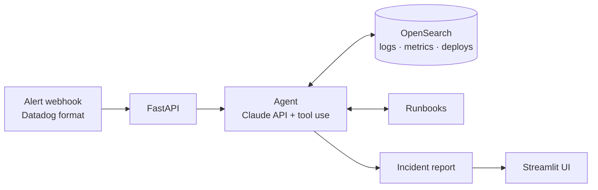

# AI Incident Copilot

> An AI on-call agent: it receives a Datadog-style alert, investigates logs, metrics and recent deploys on its own, and writes the incident summary — impact, root-cause hypothesis and runbook next steps.

[](https://github.com/EilonShetrit/ai-incident-copilot/actions/workflows/ci.yml)
[](https://codespaces.new/EilonShetrit/ai-incident-copilot)

> **All data in this project is synthetic.** No real systems, customers or logs are used.

🚧 **Status:** early development. The first end-to-end scenario, *"5xx spike after a deploy"*, is in progress.

## Why

When an alert fires, the first 10–15 minutes of on-call go to the same routine: open the dashboard, pull logs for the window, check what was deployed, look at downstream services, find the runbook. This project hands that routine to an agent, so the engineer starts from a written hypothesis instead of a blank screen.

## How it works



The agent calls tools such as `search_logs`, `get_metrics`, `get_deploy_events` and `get_runbook`, and every claim in the final report is backed by evidence from a tool result.

## Quickstart

**Option A: GitHub Codespaces (nothing to install).** Click the badge above, add `ANTHROPIC_API_KEY` as a [Codespaces secret](https://docs.github.com/en/codespaces/managing-your-codespaces/managing-your-account-specific-secrets-for-github-codespaces), then:

```bash
make up     # start OpenSearch
make seed   # load the synthetic incident data
make test   # run tests
make api    # start the API on :8000 (docs at /docs)
```

**Option B: locally.** Requires Docker, Python 3.12 and [uv](https://docs.astral.sh/uv/).

```bash
cp .env.example .env   # add your ANTHROPIC_API_KEY
make install
make up
make seed
```

Run `make help` for all commands.

## Investigation tools

Each tool returns a compact summary (counts, top messages, min/avg/max), not thousands of raw
lines, so the agent's context stays small and focused. Every tool also runs from the terminal:

```bash
uv run python -m app.tools get_deploy_events --start now-30m --end now
uv run python -m app.tools search_logs --service payments --level ERROR --start now-15m --end now
uv run python -m app.tools get_metrics --service api-gateway --start now-20m --end now
uv run python -m app.tools get_service_map
uv run python -m app.tools get_runbook --name high_5xx_rate
```

| Tool | What it answers |
|---|---|
| `get_deploy_events` | What changed, and when? |
| `search_logs` | What are the errors, from which version and host? |
| `get_metrics` | How bad is it, and since when? |
| `get_service_map` | Who calls whom, and who owns it? |
| `get_runbook` | What does our process say to do next? |

## The scenario

A small shop: `api-gateway → checkout → payments → postgres`, plus `inventory`.
At T+0, `payments v2.4.0` ships with its DB connection pool cut from 50 to 5. Two minutes later
requests start timing out waiting for a connection: `payments` returns 503, `checkout` returns 502,
and the monitor fires on **`api-gateway`** at T+5 with ~18% 5xx. `inventory` stays healthy.

The alert points at the gateway; the root cause is two hops downstream. The full timeline and the
expected conclusion live in [`scenarios/5xx_after_deploy.yaml`](scenarios/5xx_after_deploy.yaml).

## Tech stack

Python 3.12 · FastAPI · Claude API (tool use) · OpenSearch · Streamlit · Docker Compose · GitHub Actions

## Roadmap

- [x] Project skeleton, dev container, CI
- [x] Synthetic microservice logs, metrics and deploy events
- [x] Investigation tools over OpenSearch
- [ ] Agent loop with structured incident report
- [ ] Alert webhook API
- [ ] Streamlit UI with live investigation timeline
- [ ] Scenario eval against ground truth
- [ ] Demo video

## License

[MIT](LICENSE)
