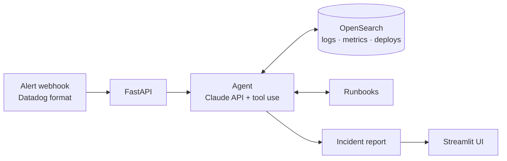

# AI Incident Copilot

> An AI on-call agent: it receives a Datadog-style alert, investigates logs, metrics and recent deploys on its own, and writes the incident summary — impact, root-cause hypothesis and runbook next steps.

[](https://github.com/EilonShetrit/ai-incident-copilot/actions/workflows/ci.yml)
[](https://codespaces.new/EilonShetrit/ai-incident-copilot)

> **All data in this project is synthetic.** No real systems, customers or logs are used.

**Status:** MVP complete. One end-to-end scenario, *"5xx spike after a deploy"*, from webhook to report, with a ground-truth eval.

<!-- Screenshot: add docs/screenshot.png from a real run and reference it here. -->

## Why

When an alert fires, the first 10–15 minutes of on-call go to the same routine: open the dashboard, pull logs for the window, check what was deployed, look at downstream services, find the runbook. This project hands that routine to an agent, so the engineer starts from a written hypothesis instead of a blank screen.

## The scenario

A small shop: `api-gateway → checkout → payments → postgres`, plus `inventory`.
At T+0, `payments v2.4.0` ships with its DB connection pool cut from 50 to 5. Two minutes later
requests start timing out waiting for a connection: `payments` returns 503, `checkout` returns 502,
and the monitor fires on **`api-gateway`** at T+5 with ~18% 5xx. `inventory` stays healthy.

The alert points at the gateway; the root cause is two hops downstream. The full timeline and the
expected conclusion live in [`scenarios/5xx_after_deploy.yaml`](scenarios/5xx_after_deploy.yaml).

## How it works



The agent calls tools such as `search_logs`, `get_metrics`, `get_deploy_events` and `get_runbook`, and every claim in the final report is backed by evidence from a tool result.

## Quickstart

**Option A: GitHub Codespaces (nothing to install).** Click the badge above, add `ANTHROPIC_API_KEY` as a [Codespaces secret](https://docs.github.com/en/codespaces/managing-your-codespaces/managing-your-account-specific-secrets-for-github-codespaces), then:

```bash
make up     # start OpenSearch
make seed   # load the synthetic incident data
make investigate  # let the agent investigate the sample alert
make api    # start the API (terminal 1)
make ui     # start the UI on :8501 (terminal 2)
make test   # run tests
```

**Option B: everything in Docker.** Requires only Docker:

```bash
export ANTHROPIC_API_KEY=...   # or put it in .env
make demo                      # OpenSearch + seed + API on :8000 + UI on :8501
```

**Option C: locally.** Requires Docker, Python 3.12 and [uv](https://docs.astral.sh/uv/).

```bash
cp .env.example .env   # add your ANTHROPIC_API_KEY
make install
make up
make seed
```

Run `make help` for all commands.

## Investigation tools

Each tool returns a compact summary (counts, top messages, min/avg/max), not thousands of raw
lines, so the agent's context stays small and focused. Every tool also runs from the terminal:

```bash
uv run python -m app.tools get_deploy_events --start now-30m --end now
uv run python -m app.tools search_logs --service payments --level ERROR --start now-15m --end now
uv run python -m app.tools get_metrics --service api-gateway --start now-20m --end now
uv run python -m app.tools get_service_map
uv run python -m app.tools get_runbook --name high_5xx_rate
```

| Tool | What it answers |
|---|---|
| `get_deploy_events` | What changed, and when? |
| `search_logs` | What are the errors, from which version and host? |
| `get_metrics` | How bad is it, and since when? |
| `get_service_map` | Who calls whom, and who owns it? |
| `get_runbook` | What does our process say to do next? |

## The agent

```bash
uv run python -m app.agent --alert samples/alert_5xx.json          # Markdown report
uv run python -m app.agent --alert samples/alert_5xx.json --json   # report + full trace
```

The agent gets the alert ([`samples/alert_5xx.json`](samples/alert_5xx.json), Datadog webhook
format) and runs a tool-use loop with Claude: it decides which tool to call, reads the result and
decides again, until it can write the report. Every tool call is printed as it happens and kept
in a trace.

- **Structured output.** The final answer is constrained to a JSON schema generated from the
  [`IncidentReport`](app/agent/schemas.py) Pydantic model: severity, impact, impacted and
  ruled-out services, root cause with confidence, evidence per tool, timeline and next steps.
- **Validated tool calls.** Each tool's input schema comes from a Pydantic model, and the same
  model validates Claude's arguments. Bad arguments or a failing tool go back to Claude as an
  error it can recover from, instead of crashing the run.
- **Guardrails.** A turn limit, explicit handling of refusals and `max_tokens`, and
  server-side model fallbacks if a request is declined.
- **Tested without the API.** [`tests/test_agent.py`](tests/test_agent.py) drives the loop with
  a scripted fake Claude client, so CI needs no API key.

## The UI

`make api` in one terminal, `make ui` in another, then open port 8501 and click
**Fire sample alert**. The page shows each tool call as the agent makes it, then the report:
severity, root cause and confidence, impacted vs. ruled-out services, next steps, the evidence
behind each claim, and the error rate of every service involved. The UI talks only to the API,
the same way a real alerting pipeline would.

## Alert webhook API

Point a Datadog webhook (or anything that speaks its payload format) at the API, and the agent
investigates in the background:

```bash
make api      # terminal 1: start the API on :8000
make alert    # terminal 2: send samples/alert_5xx.json
# {"incident_id":"inc-3f9a1c2e","status":"investigating","duplicate":false}

curl -s localhost:8000/incidents/inc-3f9a1c2e            # trace so far, then the report
curl -s localhost:8000/incidents/inc-3f9a1c2e/report.md  # report as Markdown
```

| Endpoint | What it does |
|---|---|
| `POST /webhooks/datadog` | Opens an incident and starts the investigation. Returns `202` at once. |
| `GET /incidents` | All incidents, newest first. |
| `GET /incidents/{id}` | Status (`investigating`, `resolved`, `failed`), the live tool-call trace and the report. |
| `GET /incidents/{id}/report.md` | The report as Markdown. |

The webhook behaves the way on-call tooling should:

- **Fast acknowledgement.** An investigation takes a minute or two, longer than a webhook
  sender waits, so it runs in the background and the response carries the incident id.
- **Idempotent.** Datadog retries failed deliveries and re-notifies while a monitor stays red.
  An alert that is already under investigation returns the existing incident.
- **Only triggers start work.** `Recovered` notifications are acknowledged and ignored.
- **Optional shared secret.** Set `WEBHOOK_TOKEN` and the endpoint requires a matching
  `X-Webhook-Token` header.

Interactive docs are at `/docs`. Ready-made requests are in [`api/requests.http`](api/requests.http)
(VS Code REST Client, preinstalled in the dev container) and a
[Postman collection](api/ai-incident-copilot.postman_collection.json) that chains the incident id
between requests.

## Evaluation

An agent that sounds confident is not the same as an agent that is right. `make eval` runs the
agent on the scenario several times, re-seeding fresh data each time, and grades every report
against the scenario's `ground_truth`:

| Check | Passes when |
|---|---|
| `root_cause_service` | The root cause is `payments`, not the alerted `api-gateway` |
| `root_cause_explained` | The hypothesis names the deploy (`v2.4.0`) and the mechanism (DB pool) |
| `impacted_services` | Exactly `api-gateway`, `checkout`, `payments` |
| `healthy_ruled_out` | `inventory` is listed as ruled out, not impacted |
| `mitigation_first` | The first next step is rolling back `payments` |
| `evidence_backed` | The evidence cites at least three different tools |

Results land in [`evals/results/`](evals/results/): one JSON per eval with every report, and
`latest.md` with a pass/fail table. The [Eval workflow](.github/workflows/eval.yml) runs the same
thing in GitHub Actions on demand. The scoring itself is unit-tested, so CI checks the grader
without calling the API.

## Design decisions

- **A hand-written tool-use loop, not a framework.** Every tool call is recorded with its input,
  result and duration, and streamed to the UI. The loop also owns the guardrails: a turn limit,
  validated tool arguments, and errors handed back to the model instead of crashing the run.
- **Tools return summaries, not raw logs.** `search_logs` returns counts by level, status code and
  version, plus the top messages, so the model reasons over a few hundred tokens instead of
  thousands of lines. That keeps it fast, cheap and focused.
- **A structured report.** The final answer is constrained to a JSON schema generated from a
  Pydantic model, so the API, the UI and the eval all consume the same typed object.
- **Graded against ground truth.** The scenario file holds the expected answer, and the eval
  checks every run against it. "It looked right in the demo" is not a test.
- **Built like on-call tooling.** The webhook acknowledges at once and investigates in the
  background, ignores recoveries, deduplicates retries, and can require a shared secret.

## Project layout

```
app/
  agent/       tool-use loop, prompts, report schema, tool definitions
  api/         FastAPI: webhook, incidents, metrics
  tools/       search_logs, get_metrics, get_deploy_events, get_service_map, get_runbook
  incidents/   in-memory incident store
ui/            Streamlit app (talks only to the API)
generator/     synthetic logs, metrics and deploys from a scenario file
scenarios/     the incident timeline and its ground truth
evals/         grading against ground truth, results
catalog/       service map        runbooks/   on-call runbooks
```

## Tech stack

Python 3.12 · FastAPI · Claude API (tool use) · OpenSearch · Streamlit · Docker Compose · GitHub Actions

## Roadmap

- [x] Project skeleton, dev container, CI
- [x] Synthetic microservice logs, metrics and deploy events
- [x] Investigation tools over OpenSearch
- [x] Agent loop with structured incident report
- [x] Alert webhook API
- [x] Streamlit UI with live investigation timeline
- [x] Scenario eval against ground truth
- [x] Docker image and one-command demo
- [ ] Demo video

## License

[MIT](LICENSE)
